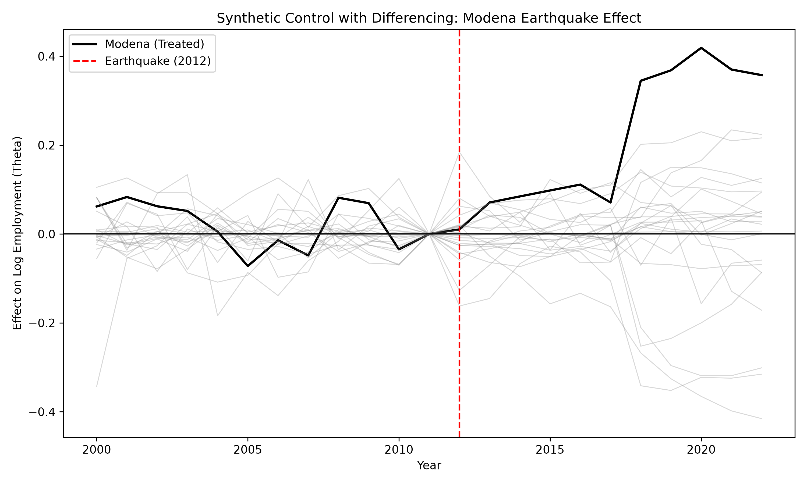
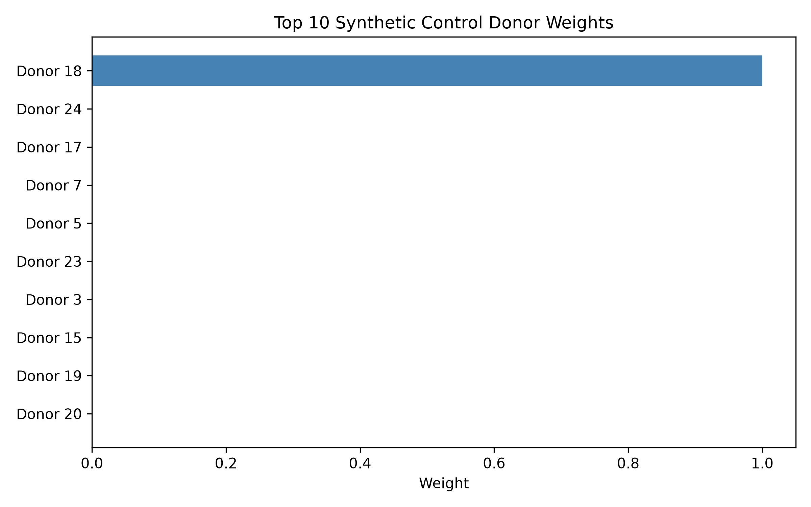

# Synthetic Control with Differencing: Italian Earthquake Application

An independent reproduction of the SCD estimator from [Rincon & Song (2026)](https://arxiv.org/abs/2510.26106), applied to Italian NUTS-3 regional data to estimate the economic impact of the 2012 Emilia Earthquake on Modena.

## 📖 Overview
This repository implements the **Synthetic Control with Differencing (SCD)** method from scratch. Unlike standard Synthetic Control (SC), SCD differences the outcomes against the last pre-treatment period. This absorbs time-invariant fixed effects and makes the pre-treatment fit robust to permanent unit-level differences (like the North-South economic divide in Italy).

## 📊 Empirical Application
**The Shock:** The May 2012 Emilia-Romagna earthquakes.
**Treated Unit:** Modena (NUTS-3: ITH54).
**Donor Pool:** 25 Italian provinces, screened to exclude the Emilia-Romagna region, adjacent shock zones, and provinces with their own major economic shocks during the window.
**Outcome:** Log Employment (thousands of persons).
**Time Window:** 2000 - 2022 (Treatment occurs in 2012).

### Results
*   **Average Treatment Effect on the Treated (ATT):** `0.2096`
*   **Placebo p-value:** `0.0769` (Significant at the 10% level)

**Interpretation:** The massive post-earthquake reconstruction effort (government and EU transfers) resulted in a statistically significant *increase* in long-term local employment, offsetting the immediate destructive shock. 

### 📈 Visual Results
**Effect Path and Placebos:**


**Donor Weights:**


## 📂 Repository Structure
*   `PAPER_SPEC.md`: The implementation contract mapping paper equations to code.
*   `VERIFICATION.md`: The audit matrix proving the code matches the paper.
*   `src/fetch_data.py`: Pipeline to download Eurostat NUTS-3 data.
*   `src/scd.py`: Core SCD estimator (SLSQP simplex optimization).
*   `src/run_scd.py`: Main pipeline (Donor screening, estimation, placebo inference).
*   `src/make_plots.py`: Generates the event study and placebo plots.

## 🚀 Reproducibility (60-Second Quick Start)
```bash
# 1. Install dependencies
pip install -r requirements.txt

# 2. Download data from Eurostat
python src/fetch_data.py

# 3. Run the SCD estimation and placebo inference
python src/run_scd.py

# 4. Generate figures
python src/make_plots.py